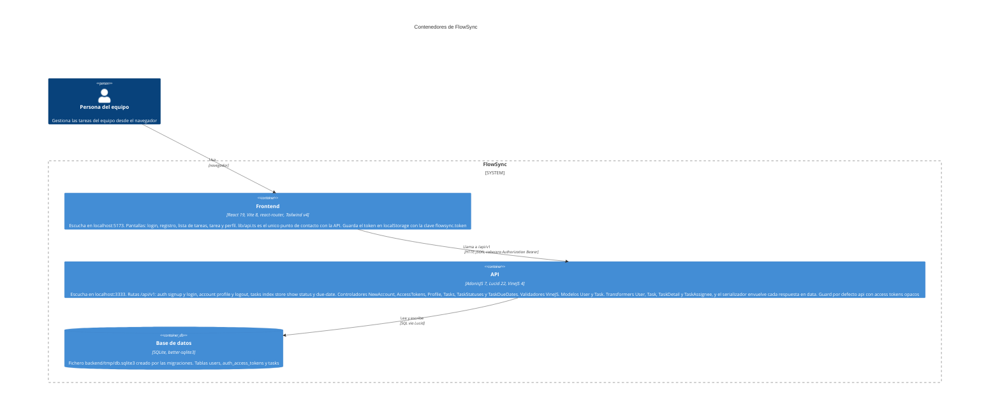

# Arquitectura de FlowSync

Este diagrama muestra los contenedores de FlowSync tal y como están hoy en el código: un frontend React que corre en el navegador, una API AdonisJS que atiende `/api/v1` y una base de datos SQLite en un fichero local. Las flechas indican quién llama a quién y con qué protocolo; cada caja resume lo que hay dentro de ella (rutas, controladores, modelos, transformers, tablas y pantallas).

Fuentes leídas: `backend/start/routes.ts`, `backend/start/kernel.ts`, `backend/config/{auth,database,cors}.ts`, `backend/app/{controllers,models,transformers,validators}/`, `backend/providers/api_provider.ts`, `backend/database/migrations/`, `frontend/src/{main.tsx,routes,pages,auth,lib/api.ts}` y los `package.json` de ambos proyectos. No se dibuja nada que no salga de esos ficheros.
