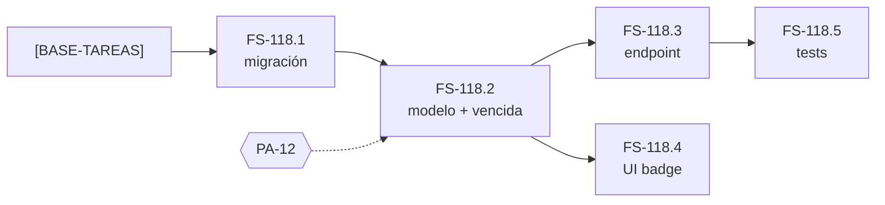

# Tickets de FS-118: Fechas de vencimiento y tareas vencidas

- **Historia:** [`us-fechas-vencimiento.md`](us-fechas-vencimiento.md)
- **Definition of Done:** [`../definition-of-done.md`](../definition-of-done.md), según el tipo de cada ticket.

Los tickets heredan los tres criterios de la historia:

- **C1:** fijar una fecha de vencimiento.
- **C2:** una tarea vencida y no terminada aparece marcada como vencida.
- **C3:** una tarea terminada nunca aparece como vencida.

## Bloqueos previos

- **[BASE-TAREAS]:** las tareas, sus estados y la lista todavía no existen. Ningún ticket de esta historia puede empezar hasta que estén construidas.
- **PA-12** (ver el PRD): falta decidir con qué reloj se considera que una fecha "ya pasó" en un equipo repartido en varios husos horarios. Mientras no se decida, FS-118.2 no se puede cerrar.

## Tickets

| ID | Título | Tipo | Criterios | Depende de | Talla |
|---|---|---|---|---|---|
| FS-118.1 | Migración: la fecha de vencimiento en las tareas | Migración/DB | C1 | [BASE-TAREAS] | S |
| FS-118.2 | Modelo: fecha de vencimiento y regla de vencida | Modelo/Dominio | C2, C3 | FS-118.1, PA-12 | M |
| FS-118.3 | Endpoint: fijar la fecha y exponerla junto con la marca de vencida | Endpoint/API | C1, C2, C3 | FS-118.2 | M |
| FS-118.4 | UI: badge de vencida en la lista | Frontend | C2, C3 | FS-118.2 | S |
| FS-118.5 | Tests de los criterios de FS-118 | Test | C1, C2, C3 | FS-118.3 | M |

### Riesgo de cada talla

- **FS-118.1 (S), riesgo bajo.** Sigue el patrón de las migraciones que ya hay en el repo. `schema.ts` sale sin formato al regenerarse y hay que formatearlo.
- **FS-118.2 (M), riesgo alto.** Contiene el primer test unitario del repo y necesita un "hoy" controlado. Depende de PA-12: si esa decisión cambia, hay que rehacer la regla y sus tests.
- **FS-118.3 (M), riesgo medio.** Toca validator, controller, ruta, transformer y el registro generado. La fecha tiene que tratarse como un día sin hora, o se desplazará según el huso horario. Hereda el bloqueo de FS-118.2.
- **FS-118.4 (S), riesgo medio.** La fecha puede mostrarse un día desplazada según el huso de quien mira. Solo se verifica a mano.
- **FS-118.5 (M), riesgo medio.** Son los primeros tests funcionales del repo: hay que montar el aislamiento de la base de datos y un usuario con sesión. Ese coste se paga una sola vez.

## Grafo de dependencias

## Orden de implementación

1. [BASE-TAREAS], que es un requisito previo. PA-12 se decide en paralelo.
2. FS-118.1
3. FS-118.2
4. FS-118.3
5. FS-118.5 y FS-118.4

## Puntos abiertos de esta descomposición

- **Fijar la fecha desde la interfaz:** ningún ticket permite que una persona ponga la fecha desde la UI. C1 queda cubierto solo hasta el endpoint. Falta confirmar si es intencionado o si hace falta otro ticket de tipo Frontend.
- **Origen de la flecha de FS-118.4:** en el grafo acordado, la flecha hacia FS-118.4 sale de FS-118.2. Pero la interfaz recibe la marca de vencida a través del endpoint (FS-118.3). Falta confirmar si FS-118.4 debe depender también de FS-118.3.
- **Cambiar y quitar la fecha:** la formulación de la historia dice "poner, cambiar o quitar", pero sus criterios solo cubren fijarla.
