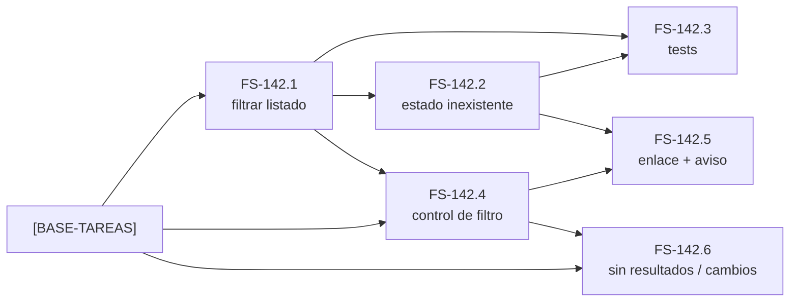

# Tickets de FS-142: Filtrar las tareas por estado

- **Historia:** [`us-filtrar-por-estado.md`](us-filtrar-por-estado.md)
- **Definition of Done:** [`../definition-of-done.md`](../definition-of-done.md), según el tipo de cada ticket.

Los tickets heredan los criterios de la historia, numerados por su orden en el archivo. Los marcados con \* están **[PROPUESTO]**, todavía sin aprobar.

| Código | Criterio |
|---|---|
| C1 | Filtro por defecto |
| C2 | Un solo estado |
| C3 | Varios estados |
| C4 | Mostrar las hechas |
| C5 | Se ve qué filtro está activo |
| C6 | Los cambios de los demás respetan el filtro |
| C7 | Estado que no existe |
| C8\* | Qué se muestra tras el aviso |
| C9\* | Mezcla de estados válidos e inválidos |
| C10\* | Filtro válido sin resultados |
| C11\* | No se pueden quitar todos los estados |
| C12\* | Una tarea deja de cumplir el filtro |
| C13\* | Crear una tarea que el filtro oculta |
| C14\* | El filtro es personal |
| C15\* | Al volver, el filtro por defecto |

## Bloqueos previos

- **[BASE-TAREAS]:** las tareas, sus tres estados y la lista todavía no existen. Ningún ticket puede empezar sin ellos. Además, C6 depende de que la lista se mantenga al día (RF-21, de la épica E3).
- **Criterios sin aprobar:** 8 de los 15 criterios siguen como **[PROPUESTO]**. Si se rechazan, FS-142.5 y FS-142.6 se reducen o desaparecen.

## Tickets

| ID | Título | Tipo | Criterios | Depende de |
|---|---|---|---|---|
| FS-142.1 | Filtrar el listado de tareas por uno o varios estados, con el filtro por defecto | Endpoint/API | C1–C4 | [BASE-TAREAS] (listado) |
| FS-142.2 | Rechazar estados que no existen y avisar de cuáles son válidos | Endpoint/API | C7, C9\* | FS-142.1 |
| FS-142.3 | Tests funcionales del filtro por estado | Test | C1–C4, C7, C9\* | FS-142.1, FS-142.2 |
| FS-142.4 | Control de filtro por estado en la lista | Frontend | C1–C6, C11\*, C14\*, C15\* | FS-142.1, [BASE-TAREAS] (lista) |
| FS-142.5 | Abrir la lista con un filtro desde un enlace y avisar si el estado no existe | Frontend | C7, C8\*, C9\* | FS-142.2, FS-142.4 |
| FS-142.6 | Mensajes de "sin resultados" y tareas que cambian de estado con el filtro activo | Frontend | C10\*, C12\*, C13\* | FS-142.4, [BASE-TAREAS] (crear tarea y cambiar estado) |

Ningún ticket es de tipo Migración/DB ni Modelo/Dominio: el filtro trabaja sobre los estados que ya aporta [BASE-TAREAS]. Los tickets de esta historia no están estimados.

## Grafo de dependencias

## Orden de implementación

1. [BASE-TAREAS] (requisito previo)
2. FS-142.1
3. FS-142.2 y FS-142.4, en paralelo
4. FS-142.3 y FS-142.5
5. FS-142.6

## Puntos abiertos de esta descomposición

- **En qué capa se filtra.** El reparto entre backend y frontend sale de C7: hay que rechazar un estado que no existe aunque llegue desde un enlace. Si en la implementación se decide filtrar solo en el navegador, FS-142.1–FS-142.3 se funden en FS-142.4–FS-142.5. Los criterios no cambian.
- **C9\* condiciona a FS-142.2.** No es lo mismo aplicar los estados válidos y avisar del inválido que rechazar el filtro entero. Hasta que se apruebe C9, FS-142.2 no tiene un comportamiento cerrado.
